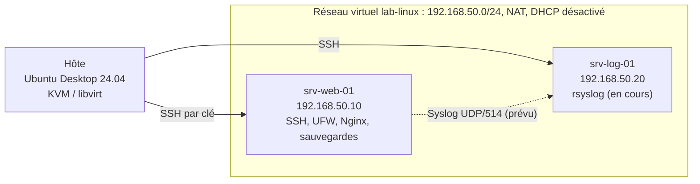

# Administration système Linux

Laboratoire personnel d'administration de serveurs Ubuntu : accès SSH par clé, pare-feu, Nginx en HTTPS, sauvegardes automatisées et vérifiées, puis centralisation des journaux.

> [!NOTE]
> Ce laboratoire est réalisé dans un environnement virtualisé, à des fins pédagogiques. Chaque fonctionnalité est documentée selon son état réel : **validée** (preuve liée), **en cours** ou **prévue**.

## État du laboratoire

| Composant | État | Documentation | Preuves principales |
|---|---|---|---|
| Infrastructure et réseau | Validé | [01](docs/01-infrastructure.md), [02](docs/02-reseau.md) | [`hostnamectl.txt`](infrastructure/hostnamectl.txt), [`ip-route.txt`](reseau/ip-route.txt) |
| SSH par clé, durcissement | Validé | [03](docs/03-ssh.md) | [`sshd-effective.txt`](ssh/sshd-effective.txt) |
| Pare-feu UFW | Validé | [04](docs/04-ufw.md) | [`ufw-status.txt`](ufw/ufw-status.txt) |
| Nginx et redirection HTTP vers HTTPS | Validé | [05](docs/05-nginx.md) | [`nginx-effective.txt`](nginx/nginx-effective.txt), [`http-redirect.txt`](nginx/http-redirect.txt) |
| HTTPS (TLS 1.3, certificat autosigné) | Validé | [06](docs/06-https-tls.md) | [`curl-https-host.txt`](https/curl-https-host.txt), [`certificate-info.txt`](https/certificate-info.txt) |
| Sauvegarde Bash et cron | Validé | [07](docs/07-sauvegarde.md) | [`backup-log.txt`](backup/backup-log.txt) (exécution automatique du 22/10/2026 à 02:00:01 UTC) |
| Vérification et restauration des sauvegardes | Validé | [07](docs/07-sauvegarde.md) | [`restore-test.txt`](backup/restore-test.txt), [`retention-test.txt`](backup/retention-test.txt) |
| Journaux centralisés (`srv-log-01`) | En cours | [ROADMAP](ROADMAP.md) | preuves à ajouter |
| Utilisateurs, groupes, permissions | Prévu | [ROADMAP](ROADMAP.md) | |
| Stockage et exploitation | Prévu | [ROADMAP](ROADMAP.md) | |

## Architecture



| Élément | Valeur |
|---|---|
| Hôte | Ubuntu Desktop 24.04 LTS |
| Virtualisation | KVM/libvirt, virt-manager |
| Machines virtuelles | Ubuntu Server (`srv-web-01` : 24.04.5 LTS, relevé avec `hostnamectl`) |
| Réseau | `lab-linux`, 192.168.50.0/24, NAT, passerelle 192.168.50.1, DHCP désactivé |
| Adressage | IPv4 statique (Netplan) |

## Mode de travail

L'administration se fait en ligne de commande, par SSH depuis l'hôte (utilisateur `stone`) vers les machines virtuelles (utilisateur `dokja`), comme dans un contexte professionnel. Dans le [carnet de commandes](docs/commandes.md), chaque commande indique la machine concernée (`[HÔTE]` ou `[SERVEUR]`).

Chaque fonctionnalité suit le même cycle : comprendre le service, préparer la configuration, l'appliquer sur la bonne machine, vérifier le résultat, tester depuis une autre machine lorsque c'est pertinent, conserver une preuve, puis documenter les limites et le reste à faire.

## Choix assumés et limites

- **SSH ouvert à toute source** (IPv4 et IPv6) : choix assumé pour pouvoir administrer depuis n'importe quel réseau. La protection repose sur l'authentification par clé uniquement : mot de passe, authentification interactive au clavier et connexion directe de `root` sont désactivés, ce que `sshd -T` confirme. Ces réglages ne couvrent pas une faille de `sshd` exploitable avant l'authentification ; dans un contexte réel, un VPN ou un bastion, avec une règle limitée au réseau d'administration, réduirait l'exposition. Détail : [03](docs/03-ssh.md).
- **Sauvegardes locales** : stockées sur le serveur qu'elles protègent, elles ne couvrent pas la perte du serveur. Une copie hors machine est prévue ([ROADMAP](ROADMAP.md)).
- **Portée de la restauration** : le test porte sur tous les fichiers de l'archive (24 au 25/10/2026 : contenu, droits, propriétaires), pas sur une restauration complète du serveur. La clé privée TLS est volontairement exclue de l'archive.
- **Certificat autosigné** : l'avertissement du navigateur est attendu ; la vérification TLS se fait avec `curl --cacert`.
- **Journaux** : le transport retenu pour l'étape en cours est Syslog UDP/514, sans acquittement ni chiffrement. TCP/6514 avec TLS est réservé à un laboratoire ultérieur.

## Compétences mises en pratique

- Administration Linux et systemd.
- Réseau IPv4 et diagnostic de connectivité ([02](docs/02-reseau.md)).
- SSH par clé et durcissement ([03](docs/03-ssh.md)).
- Pare-feu UFW ([04](docs/04-ufw.md)).
- Nginx et HTTPS ([05](docs/05-nginx.md), [06](docs/06-https-tls.md)).
- Bash, cron et automatisation ([07](docs/07-sauvegarde.md)).
- Sauvegarde, intégrité et restauration ([07](docs/07-sauvegarde.md)).
- Virtualisation avec KVM/libvirt ([01](docs/01-infrastructure.md)).

## Structure du dépôt

```text
.
├── README.md
├── ROADMAP.md        Étapes en cours et prévues
├── docs/             Documentation par étape (01 à 07) et carnet de commandes
├── scripts/          Scripts de vérification (sauvegardes, dépôt)
├── infrastructure/   Preuves : système
├── reseau/           Preuves : adressage et routage
├── ssh/              Preuves : configuration SSH
├── ufw/              Preuves : règles du pare-feu
├── nginx/            Preuves : configuration Nginx
├── https/            Preuves : certificat et tests TLS
└── backup/           Preuves : script, cron, journaux et vérifications
```

## Scripts

```bash
# Sur srv-web-01 : contrôle de la dernière sauvegarde (une sortie texte par contrôle)
sudo bash scripts/verifier-sauvegarde.sh

# Sur la machine qui prépare la publication : liens, secrets, cohérence des preuves
bash scripts/verifier-depot.sh
```

## Sécurité du dépôt

Aucune clé privée, aucun mot de passe et aucune archive de sauvegarde ne sont versés dans le dépôt (`.gitignore` et `scripts/verifier-depot.sh`). `stone` et `dokja` sont des noms d'utilisateur du laboratoire ; l'authentification repose sur des clés.

---

Projet pédagogique personnel : administration système Linux.
